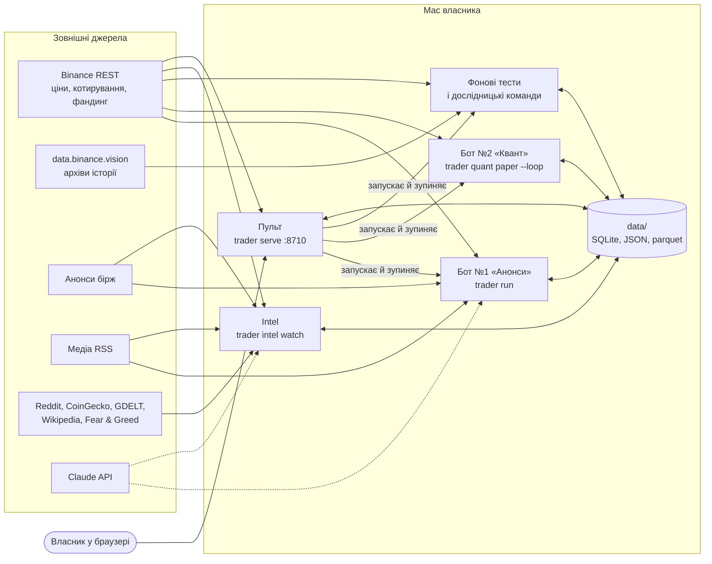
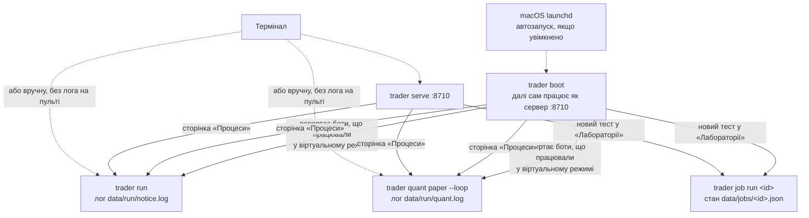
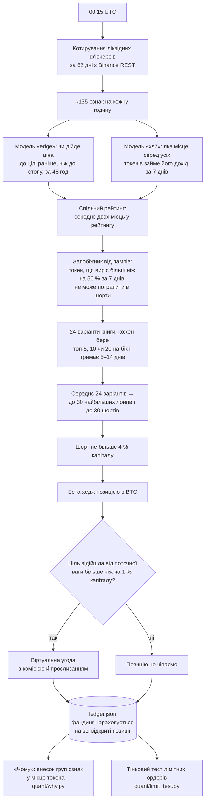
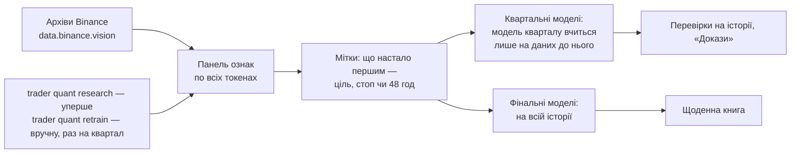
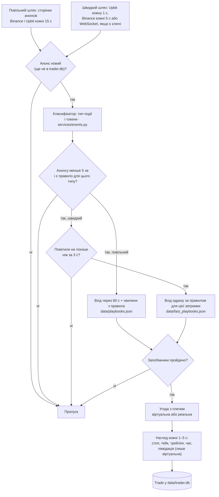
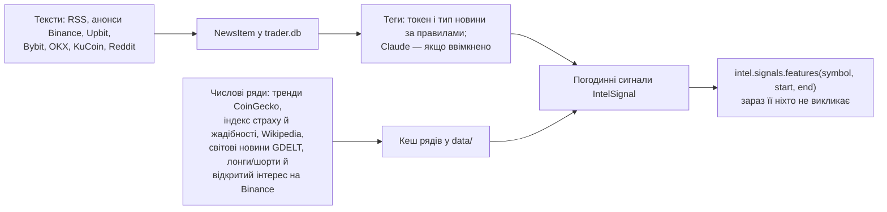
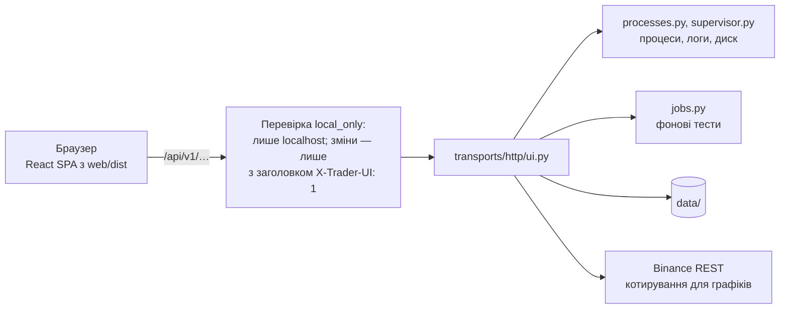

# Архітектура Крипто-Трейдера

Крипто-Трейдер — програма, яка працює на Mac власника. Вона досліджує безстрокові ф'ючерси Binance і торгує ними. Ще
жодна угода не пройшла на біржі з реальними грошима: обидва боти торгують віртуальними грошима. Ціни справжні,
комісії й інші витрати враховано, але ордери на біржу не йдуть.

**Приклад одного дня.** О 00:15 UTC бот «Квант» завантажує з Binance годинні котирування всіх ліквідних ф'ючерсів за
останні 62 дні. Дві моделі машинного навчання (LightGBM) оцінюють кожен токен. Бот складає портфель: до 30 токенів
купує, до 30 продає в шорт. Із цим портфелем він перебудовує віртуальний рахунок, який почався з $1000 і накопичує
прибутки та збитки. Угоди дня записуються в журнал `data/quant/paper/ledger.json`. Власник бачить їх на пульті
http://127.0.0.1:8710.

## Словник

| Слово | Що означає тут |
|---|---|
| Власник | Людина, якій належать проєкт і рахунок Binance. Вона ставить задачі й дає «так» у чаті з Claude; усі зміни в проєкті роблять сесії Claude |
| Безстроковий ф'ючерс (USDⓈ-M perpetual) | Контракт на ціну токена без дати погашення, з розрахунками в USDT. Його можна купити (лонг) чи продати (шорт). Пара — це ф'ючерс токена, наприклад SOLUSDT; «токен» і «пара» в тексті означають одне |
| Ліквідний ф'ючерс | Ф'ючерс, у якого середній денний оборот у USDT за 30 днів хоча б раз за останні 62 дні сягав $10 млн |
| Свічка | Ціни за інтервал (тут — годину): відкриття, максимум, мінімум, закриття, плюс оборот |
| ATR | Середній розмах ціни за свічку; «+3 ATR» — ціна вища на три такі розмахи |
| Плече угоди | У скільки разів позиція більша за заставу під неї. «10×» — позиція $1000 на заставі $100 |
| Експозиція | Сума всіх позицій відносно капіталу. «2×» — позиції на $2000 при капіталі $1000 |
| Книга | Портфель «Кванта»: список токенів і частка капіталу в кожному (вага); у шортів вага від'ємна |
| Ребаланс | Перебудова рахунку під нову книгу: докупити, продати, закрити |
| Фандинг | Платіж між лонгами й шортами кожні кілька годин, поки позиція відкрита |
| Прослизання | Різниця між ціною в момент рішення і ціною, за якою ордер справді виконався |
| Стоп, тейк, трейлінг | Вихід зі збитком, вихід із прибутком, стоп, що підтягується за ціною |
| Ізольована / крос-маржа | Ізольована: застава окремо для кожної угоди, і збиток угоди не більший за її заставу. Крос: одна спільна застава на весь рахунок |
| Ліквідація | Біржа примусово закриває позицію, коли застави бракує. У віртуальному режимі бот імітує її сам |
| Бета-хедж | Позиція в BTC такого розміру, щоб рух усього ринку майже не міняв результат книги |
| Віртуальні гроші (`paper`) | Угоди за справжніми цінами без ордерів на біржі |
| Реплей (`replay`) | Справжній код бота «Анонси», прогнаний на минулих днях (`trader replay`) |
| Форвард | Перевірка «Кванта» на днях після останнього навчання моделей, на свіжих котируваннях (`trader quant forward`) |
| Walk-forward | Кожне рішення на історії ухвалюється лише з даних до цього дня, як було б наживо |
| Ознаки, панель | Ознаки — ≈135 чисел на кожну годину кожного токена (індикатори, патерни свічок, фандинг, рух BTC), з яких модель робить прогноз. Панель — таблиця ознак за всі години й токени |
| H01, I01, Q01… | Номери гіпотез у [RESEARCH.md](RESEARCH.md): H — бот «Анонси», I — ідеї, Q — бот «Квант» |
| «Лабораторія» | Сторінка пульту, де запускають фонові тести на історії |
| «Докази» | Сторінка з результатами «Кванта» на історії, яку моделі не бачили; рахує `quant/evidence.py` |
| «Пара за день» | Сторінка «Лабораторії»: 305 простих тактик (правил входу й виходу) на одному токені за один день. Це дослідницький інструмент, не симуляція бота: тактики на одній парі програють (Q43–Q44) |

## 1. З чого складається

Усі процеси і читають, і пишуть `data/`: боти беруть звідти моделі й правила угод, а записують угоди й журнали.

| Частина | Що робить | Код (у `src/trader/`) | Як запустити |
|---|---|---|---|
| Пульт | Показує стан ботів і угоди, запускає й зупиняє процеси, ставить фонові тести | `main.py`, `transports/http/`, папка `web/` у корені | `trader serve` |
| Бот №1 «Анонси» (`notice`) | Ловить анонси Binance і Upbit про лістинг, делістинг, тег моніторингу (попередження Binance, що токен можуть делістингувати) і відкриває угоду з плечем на ф'ючерсі токена | `services/trading.py`, `events.py`, `playbooks.py`, `broker.py`; `integrations/` | сторінка «Процеси» або `trader run` |
| Бот №2 «Квант» (`quant`) | Раз на добу перебудовує книгу з лонгів і шортів із бета-хеджем | `quant/` | сторінка «Процеси» або `trader quant paper --loop` |
| Фонові тести (jobs) | Перевірки на історії, форвард, книга за день, реплей «Анонсів», перенавчання, «Докази», «Пара за день» | `services/jobs.py` | пульт → «Лабораторія» |
| Дослідницькі команди | Завантажують архіви й будують панель і моделі (`trader quant research`), правила угод «Анонсів» (`trader research events`, `ticks`). Працюють від хвилин до годин | `quant/`, `services/` | термінал, у фоні |
| Intel | Збирає новини й увагу до токенів (згадки, перегляди Wikipedia, тренди CoinGecko) у погодинні сигнали. Дослідження 2026-10-24 не знайшло серед 20 сигналів жодного, що заробляє після комісій, тому боти їх не використовують і модуль зараз не запущено | `intel/` | `trader intel watch`, вручну |
| Сховище | Усе, що пишуть боти й тести (розділ 7) | `data/`, `reports/` | — |

## 2. Процеси: хто кого запускає

| Процес | Команда | Хто запускає | Коли працює | Лог |
|---|---|---|---|---|
| Сервер пульту через автозапуск | `trader boot` | launchd після входу в macOS, якщо автозапуск увімкнено | повертає боти, далі працює як сервер; якщо впаде, launchd підніме знову | `data/run/serve.log` |
| Сервер пульту вручну | `trader serve` | термінал | постійно | куди спрямує термінал (зазвичай `data/run/serve.log`) |
| Бот «Анонси» | `trader run` | сторінка «Процеси» або термінал | постійно, опитує біржі кожні 1–15 с | `data/run/notice.log`, якщо запущено з пульту |
| Бот «Квант» | `trader quant paper --loop` | сторінка «Процеси» або термінал | ребаланс щодня о 00:15 UTC; якщо ребаланс не вдався — повтор кожні 15 хв | `data/run/quant.log`, якщо запущено з пульту |
| Фоновий тест | `trader job run <id>` | «Лабораторія» | один раз | у JSON задачі |

- Пульт запускає боти окремими процесами (`services/processes.py`), тож вони переживають перезапуск сервера. Другий
  екземпляр того самого бота пульт не запустить: спершу треба зупинити перший.
- Бот, запущений з термінала, пульт теж бачить (шукає процеси `trader` у `ps`), але позначає «з терміналу» і не
  показує його лог.
- Перезавантаження Mac зупиняє все. Саме піднімається лише тоді, коли на сторінці «Процеси» увімкнено автозапуск
  (`services/supervisor.py` пише файл `~/Library/LaunchAgents/ua.crypto-trader.plist`). `boot` повертає лише ті боти,
  що працювали у віртуальному режимі й не були зупинені вручну; це видно зі стану в `data/run/<bot>.json`.
- Бот, що впав сам, ніхто не перезапускає.

## 3. Бот №2 «Квант»

### Як щодня складається книга

Як працюють кроки, які на діаграмі не очевидні:
- **Дві моделі.** «edge» — пара моделей: одна оцінює для лонга, чи дійде ціна до +3 ATR раніше, ніж до −1,5 ATR, друга
  те саме для шорта. «xs7» оцінює, яке місце серед усіх токенів займе дохід токена за 7 днів.
- **Варіанти книги.** Кожен із 24 варіантів щодня бере k найкращих токенів у лонг і k найгірших у шорт, де k — 5, 10
  чи 20. Утримання 5–14 днів означає, що вага варіанта — це середнє його виборів за останні 5, 7, 10 чи 14 днів, тож
  токен виходить із книги поступово. Ваги всередині сторони рівні або обернені до волатильності (спокійний токен
  отримує більшу частку). Разом 3 × 4 × 2 = 24 варіанти.
- **До 30 на бік.** Середнє 24 варіантів містить більше токенів. Лишаються до 30 найбільших лонгів і до 30 найбільших
  шортів (менше, якщо кандидатів менше), кожна сторона масштабується до 1× капіталу.
- **Обмеження шорту** йде після масштабування, тож шортова сторона може бути меншою за лонгову. Різницю в чутливості
  до ринку закриває бета-хедж.
- **Бета-хедж.** Для кожного токена рахується, як він рухався разом із BTC за 60 днів (бета). Позиція в BTCUSDT
  дорівнює мінус сумі «вага × бета» всіх токенів. Хедж іде поверх 2×.
- **Запобіжник від пампів** прибирає такий токен із кандидатів у шорт. Якщо шорт на ньому вже є, він згасає разом із
  середнім за днями утримання, а не закривається одразу.
- **«Чому»** після ребалансу розкладає місце кожного токена в рейтингу на внески груп ознак (тренд, моментум, фандинг,
  об'єм, BTC тощо) і показує це на сторінці «Квант».

| Правило | Значення | Де задано |
|---|---|---|
| Лонги / шорти | до 30 / до 30 | `per_side` |
| Шорт | до 4 % капіталу | `short_cap`, Q42 |
| Запобіжник від пампів | 7 днів, +50 % | `pump_guard`, Q41–Q48: найгірші дні книги — шорти на пампах |
| Експозиція | 1× лонги + 1× шорти, хедж поверх | `gross`; більша експозиція збільшує збитки швидше за прибуток (Q49–Q50) |
| Бета-хедж | бета за 60 днів | `beta_days` |
| Коридор ребалансу | 1 % капіталу на токен | `band`, Q33 |
| Варіанти | k 5 / 10 / 20, утримання 5 / 7 / 10 / 14 днів, рівні або обернені до волатильності ваги | `k`, `hold_days`, `weighting` |

Правила з таблиці задано в `ENSEMBLE` у `quant/neutral.py`, і звідти їх бере все інше: віртуальний бот
(`paper.py`), реальний виконавець (`live_exec.py`), перевірки на історії, «Докази». Цілі моделі «edge» (3 і 1,5 ATR,
48 год) записано в `data/quant/panel_meta.json` разом із панеллю, вікно котирувань 62 дні — у `quant/paper.py`.
Кожен результат книги на історії рахує та сама функція `drift`: вона торгує з учорашніх ваг, зсунутих рухом цін, лише
за межею коридору, з тими самими комісією, прослизанням і фандингом, що й віртуальний рахунок.

**Тіньовий тест лімітних ордерів** (Q51) бере ті самі угоди ребалансу й рахує, чи виконалися б вони лімітними
ордерами за 30 хвилин і скільки б це заощадило. Віртуальний рахунок він не змінює. Пише в
`data/quant/paper/limit_orders.jsonl`, підсумок — `trader quant limits`.

### Звідки беруться моделі

- Квартальні моделі потрібні для чесних чисел на історії: `model_for(day)` повертає модель, яка не бачила цього дня.
  Фінальні навчено на всій історії, що була на момент навчання, і ними торгує бот.
- Перенавчання не запускається саме: його запускає власник (тест «Перенавчання» в «Лабораторії» або
  `trader quant retrain`). Сторінка «Процеси» показує дату наступного. Замінені фінальні моделі зберігаються як
  квартальні для днів, коли ними торгували. Тому перевірка будь-якого минулого дня бере модель, яка цього дня не бачила.

### Реальні гроші

Реальний режим «Кванта» (`trader quant live --loop`, код `quant/live_exec.py`) ставить справжні ордери для тієї самої
книги на крос-маржі. Ізольована маржа ліквідувала б кожен шорт на стрибку ціни приблизно на 20 %, а такий стоп, за
Q22, руйнує книгу. Якщо капітал рахунку падає на 35 % від найвищого значення, бот закриває все й зупиняється. Кнопки,
що знімає цю зупинку, ще немає ([беклог № 25](BACKLOG.md)). Цей режим ще не запускався: журналу реальних грошей
`data/quant/live/ledger.json` немає.

## 4. Бот №1 «Анонси»

- Обидва шляхи пишуть анонс у `trader.db`. Той самий анонс торгується один раз: його бере той шлях, що записав
  першим. Рішення щодо кожного анонсу (і причину пропуску) бот дописує в `data/run/notice_decisions.jsonl`.
- **Затримка** — секунди від публікації анонсу до моменту, коли бот його побачив. Чим вона більша, тим більше ціна
  встигла зрушити. Для швидкого шляху підібрано окремі правила для затримок 0,5…5 с, але бот бере лише ті, що до 3 с.
  Повільний шлях входить не раніше ніж через 60 с після публікації (`ENTRY_LATENCY_S`) плюс хвилини з правила.
- **Правило угоди (playbook)** для типу події каже: лонг чи шорт, плече, через скільки хвилин входити (лише на
  повільному шляху), стоп, тейк, трейлінг і скільки тримати. Правила підбирають команди `trader research events`
  (повільний шлях) і `trader research ticks` (швидкий, на потоці окремих угод біржі). Кожне правило вибране лише з
  анонсів, що вийшли раніше за ті, на яких його перевіряли. Запускає їх власник вручну, коли хоче оновити правила.

| Запобіжник | Значення | Налаштування в `.env` |
|---|---|---|
| Відкритих угод одночасно | до 5 | `MAX_OPEN_POSITIONS` |
| Угод на один токен | одна | — |
| Збиток за добу | після −20 % капіталу нових угод немає | `MAX_DAILY_LOSS` |
| Застава на угоду | 20 % капіталу | `MARGIN_FRACTION` |
| Застава на один анонс | до 30 % капіталу; один анонс може назвати кілька токенів, і тоді на них разом іде не більше 30 % | `MAX_NOTICE_FRACTION` |
| Плече угоди | до 20× | `MAX_LEVERAGE` |
| Вік анонсу | старший за 5 хв не торгуємо | `MAX_NOTICE_AGE_S` |
| Швидкий шлях | лише якщо затримка ≤ 3 с | `FAST_MAX_LATENCY_S` |

Перевіряють запобіжники `Trader._blocked` і `Trader._margin` у `services/trading.py`. Режим задає змінна
`TRADING_MODE` (`paper` або `live`), яку пульт передає процесу бота. У віртуальному режимі `PaperBroker` бере живу ціну
плюс прослизання анонсу. У реальному `LiveBroker` ставить ордери через бібліотеку ccxt на ізольованій маржі, а якщо
правило має стоп, то й стоп на біржі. Тейк, трейлінг і вихід за часом робить сам бот, тож якщо процес зупиниться, на
біржі лишиться лише початковий стоп.

Новини з медіа RSS читає Claude (`ai/news_analyst.py`). Торгує за ними бот лише тоді, коли в `.env` стоїть
`LLM_NEWS_TRADING=true` (за замовчуванням вимкнено), і з тими самими запобіжниками.

## 5. Intel — модуль новин

`trader intel fetch` робить один прохід, `trader intel watch` повторює його в циклі. Claude вмикається прапорцем
`--llm` обох команд. Модуль зараз не запущено (розділ 1, таблиця).

## 6. Пульт

| Сторінка | Адреса | Що показує | Основні запити API |
|---|---|---|---|
| Огляд | `/` | Обидва боти, книга «Кванта», стрічка останніх анонсів і угод | `/overview`, `/bots` |
| Квант | `/bots/quant` | Книга, журнал, «Чому» для кожної позиції | `/quant/ledger`, `/quant/why`, `/quant/ranks`, `/quant/limit-test` |
| Анонси | `/bots/notice` | Угоди, свіжі анонси з рішенням бота щодо кожного, підсумок по днях | `/notice/trades`, `/notice/feed`, `/notice/daily` |
| Лабораторія | `/lab`, `/lab/:id` | Фонові тести і «Пара за день» | `/jobs`, `/uploads`, `/market/klines` |
| Докази | `/evidence` | Результати «Кванта» на історії, яку моделі не бачили | `/quant/evidence` |
| Процеси | `/processes` | Запуск і зупинка ботів, кнопка «Реальні гроші…», логи наживо, диск, розклад, автозапуск | `/processes`, `/bots/{bot}/start`, `/logs/{source}/stream`, `/disk`, `/schedule`, `/autostart` |

- **Захист.** Пульт керує процесами, які можуть торгувати реальними грошима. Тому сервер відповідає лише на
  localhost. Запити, що щось змінюють (POST, PUT, PATCH, DELETE), мусять мати заголовок `X-Trader-UI: 1`, а чужий сайт,
  відкритий у тому самому браузері, надіслати його не може.
- **Реальний режим** вмикає кнопка «Реальні гроші…» на сторінці «Процеси». Вона активна лише з ключами Binance у
  `.env` і просить вручну набрати фразу `LIVE NOTICE` / `LIVE QUANT`. Після цього пульт запускає бота з
  `TRADING_MODE=live`.
- **Код пульту** лежить у `web/src/`: маршрути — `App.tsx`, меню — `components/Shell.tsx`, спільні компоненти —
  `components/ui.tsx`, дизайн-правила — `docs/DESIGN.md`. `lib/types.ts` пишеться вручну й повторює JSON, який
  повертає `ui.py`, тож міняти їх треба разом. Числа й дати українською форматує `lib/format.ts`.

## 7. Дані на диску

Дані лежать у `data/`, `data_pre/` і `reports/` у корені репозиторію. Git їх не відстежує, крім верхнього рівня
`reports/*.md|*.json` (звіти досліджень).

| Шлях | Що там | Хто пише |
|---|---|---|
| `data/trader.db` | SQLite: анонси й новини (`NewsItem`), журнал угод бота «Анонси» (`Trade`, поле `mode`: paper, live чи replay), сигнали Intel (`IntelSignal`) | бот «Анонси», реплей, Intel |
| `data/quant/paper/ledger.json` | Віртуальний рахунок «Кванта»: позиції, угоди й книга за кожен день | лише бот «Квант» |
| `data/quant/paper/why/` | «Чому» для кожного дня | `quant/why.py` |
| `data/quant/paper/limit_orders.jsonl` | Тіньовий тест лімітних ордерів | `quant/limit_test.py` |
| `data/quant/panel/`, `panel_meta.json` | Панель ознак, по файлу на токен, і її налаштування | `trader quant research`, `retrain` |
| `data/quant/predictions.parquet`, `xs_predictions.parquet` | Прогнози квартальних моделей на всій історії | `trader quant research` |
| `data/quant/models/`, `xs_models/` | Квартальні й фінальні моделі «edge» і «xs7» | `trader quant research`, `retrain` |
| `data/quant/live/` | Кеш котирувань, на яких бот ухвалював рішення, книга форварду; тут з'явиться й журнал реальних грошей `ledger.json` | `quant/live.py`, `live_exec.py` |
| `data/playbooks.json`, `data/fast_playbooks.json` | Правила угод бота «Анонси» | `trader research events` / `ticks` |
| `data/klines`, `funding`, `ticks`, `universe/` | Кеш архівів Binance: свічки, фандинг, окремі угоди, список токенів за датами | `services/market_data.py`, `ticks.py`, `universe.py` |
| `data_pre/` | Окремо перебудовані панель і моделі за 2021-07…2023-06 для перевірки на нечіпаному періоді | команди `quant` з датою початку панелі |
| `data/run/` | Стан і логи процесів | пульт і запущені ним процеси |
| `data/run/notice_decisions.jsonl` | Що бот «Анонси» вирішив щодо кожного анонсу: немає правила, застарий, запізно помічений, немає ф'ючерса, заплановано, заблоковано запобіжником, увійшов | `trading.record` |
| `data/jobs/`, `data/uploads/` | Фонові тести, CSV з котируваннями для «Пари за день» | пульт |

`trader.db` і `ledger.json` — живі журнали ботів, які працюють прямо зараз. Їх не можна видаляти чи переписувати,
а експеримент не має писати в них. Автотести (pytest) працюють із тимчасовою копією (`tests/conftest.py`).

## 8. Як перевіряємо, що числа чесні

| Період | Дати | Для чого |
|---|---|---|
| Розробка | 2023-07…2024-12 | Тут підбирають налаштування |
| Перевірочний (holdout) | 2025-01…2026-09 | Перевіряють те, що підібрали |
| Нечіпаний | 2021-07…2023-06 | Перевірка вже вибраної версії. Панель і моделі перебудовано окремо (`data_pre/`), кожна модель бачить лише дані до свого кварталу. Налаштування тут не підбирають |
| Форвард | після останнього навчання (зараз з 2026-10) | Свіжі котирування, яких не бачила жодна модель |

- Новий варіант замінює робочий, лише якщо його Sharpe (дохід, поділений на коливання) кращий і на розробці, і на
  перевірочному періоді (Q32). Нечіпаний і форвард нічого не обирають: якщо там варіант гірший, заміну скасовують.
- Витрати завжди ввімкнено: комісія 0,05 %, прослизання 0,03 % (на анонсах 0,15 %), фандинг. Для «Анонсів» ще й
  ліквідація на ізольованій маржі.
- Після кожної серії експериментів у [RESEARCH.md](RESEARCH.md) дописують гіпотезу, результат і висновок. Знайдені
  дефекти — в [AUDIT.md](AUDIT.md).

## 9. Карта коду

| Папка в `src/trader/` | Що там |
|---|---|
| `core/` | Налаштування з `.env` (`config.py`), підключення до бази, логи, метрики Prometheus |
| `models/` | Таблиці SQLite `NewsItem` і `Trade` (таблиця `IntelSignal` — у `intel/models.py`). Моделі машинного навчання лежать не тут, а в `data/quant/models/` |
| `integrations/` | Клієнти зовнішніх сервісів: Binance REST і WebSocket, ccxt для реальних ордерів, Upbit, RSS, Claude (`llm.py`) |
| `ai/` | Що питати в Claude і як читати відповідь: аналіз новин |
| `services/` | Бот «Анонси» і його дослідження, бектестер на numba (`engine.py`, компільований Python для швидких розрахунків), процеси й фонові тести пульту |
| `quant/` | Бот «Квант»: ознаки, моделі, книга, віртуальний і реальний виконавці, «Чому», «Пара за день» |
| `intel/` | Модуль новин і сигналів |
| `transports/` | Команда `trader` (Typer) і HTTP API (FastAPI) |
| `bots.py`, `status.py` | Список ботів і короткий підсумок їхніх віртуальних рахунків |

## 10. Перед першою зміною

| Питання | Відповідь |
|---|---|
| Де працюю | Лише в цьому репозиторії на Mac власника. `data/` (панель, моделі, кеші архівів) git не зберігає, і є вона тільки тут; зібрати з нуля — години завантажень (`trader quant research`, `trader research events`). Боти, можливо, вже працюють і пишуть у той самий `data/` |
| Як не зачепити процеси власника | Окремого середовища немає. Фоновий тест, перезапуск бота й `trader boot` беруть код із робочої папки, тож запускай їх лише тоді, коли код у робочому стані. Не пиши експериментом у `trader.db` і `ledger.json` |
| Як підняти | `uv sync` (Python 3.13), `cd web && pnpm install`. Для віртуального режиму ключі Binance не потрібні: без них лише вимкнено WebSocket анонсів |
| Що має бути зеленим | `uv run pytest`, `uv run ruff check . && uv run ruff format --check .`, `cd web && pnpm typecheck && pnpm test`. CI запускає лише `uv run prek run --all-files` (prek — запускач перевірок форматування й ruff) |
| Як перевірити нове правило книги | Змінити `ENSEMBLE`, прогнати `trader quant neutral` (порівнює варіанти на розробці й перевірочному періоді) або тест «Квант: період на історії». Застосувати правило Q32 (розділ 8), дописати результат у RESEARCH.md, перебудувати «Докази» тестом у «Лабораторії» |
| Що станеться з віртуальним рахунком | Рахунок продовжується. Нове правило діє з першого ребалансу після перезапуску «Кванта» |
| Як розробляти пульт | Запустити тестовий сервер (`trader serve --port 8711`) і `pnpm dev:next` (Vite на :5173, що шле запити API на :8711); обидва описано в `.claude/launch.json`, конфігу запуску для Claude Code. Тестовий сервер працює з тим самим `data/`, і кнопки запуску ботів там справжні. Новий маршрут API з'являється після перезапуску сервера |
| Як зміна потрапляє в боти | Бот працює на коді, з яким його запустили. Нова версія діє після перезапуску на сторінці «Процеси». Перезапускати вдень, далеко від 00:15 UTC, і лише попередивши власника |
| Що заборонено без «так» власника | Реальний режим будь-якого бота; `pnpm build`, бо `trader serve` одразу віддає новий `web/dist` замість пульту власника; коміти; видаляти чи переписувати `trader.db` і `ledger.json` |

Повний список команд і правила коду — у `CLAUDE.md` у корені репозиторію.
